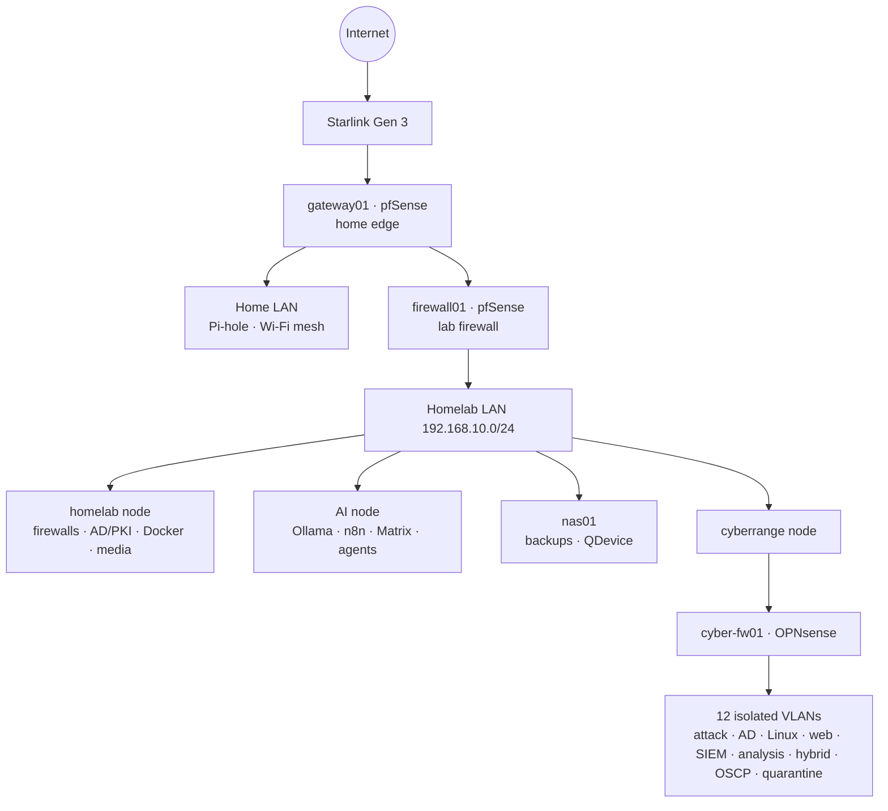

# Project Polaris — Enterprise-Style Homelab and Cyber Range

**Jesse Breedlove** · GitHub `AcinomedCyber` · B.S. Computer Science · A.A.S. Cybersecurity (85% complete)

Project Polaris is a three-node Proxmox homelab I designed, built and documented from scratch between **June and October 2026**. It is run like a small enterprise: every change goes through a gated runbook with a backup first, a validation step and written evidence. It has four parts:

- **An isolated cyber range** behind its own OPNsense firewall, with 12 VLANs: attack hosts, an Active Directory target forest, Linux and web-app targets, a Wazuh SIEM with AI-assisted alert triage, breach-and-attack simulation, a hybrid pivot capstone and an OSCP-style exam lab. Its fail-closed containment has been tested under a real outage.
- **A layered network**: Starlink → pfSense home-edge firewall → pfSense lab firewall → managed VLAN switch, with Pi-hole DNS, an AD domain and a two-tier PKI.
- **A self-hosted AI agent platform** (local LLMs on Ollama, n8n, Matrix/Element). It reads three firewalls, proposes firewall changes, writes and tests code in a sandbox, and maintains this documentation. It **cannot approve its own changes**: approval is a deterministic human command, enforced by architecture rather than by prompting.
- **A Bash configuration-backup framework** that collects, validates and archives the config of every device daily.

> All addresses are private lab addresses. Tailscale addresses, MAC addresses, serial numbers, UUIDs, account names and personal details have been replaced with placeholders. See [SANITIZATION.md](SANITIZATION.md).

---

## Architecture

| Layer | Highlights |
|---|---|
| Hardware | 3 Proxmox nodes (Ryzen 5 5500 / 48 GB; Ryzen 7 5800X3D / 64 GB + RX 7700 XT + GTX 970; Ryzen 9 7900X / 32 GB + RX 9060 XT), Asustor NAS as quorum device, Netgear GS324TP |
| Network | Double-NAT edge for a fast household bypass; port-based VLANs 10/30; OPNsense with per-zone 4-rule template, `PROTECTED_NETWORKS` block, documented attack-path exceptions, pivot-only internal segments |
| Identity | `ad.polaris` forest, tiered OU/group model, eight-GPO baseline, offline root CA + enterprise issuing CA |
| Security ops | Wazuh with Sysmon + auditd, MITRE Caldera, Infection Monkey, Atomic Red Team, local-LLM alert triage (`deepseek-r1:14b` + `llama-guard3`) |
| Offense | Kali (GPU hashcat at 11.6 GH/s NTLM via vfio), Parrot, LLM-driven tool bridge, 6-box OSCP exam simulation |
| Automation | n8n + Ansible, Bash collector framework, Forgejo merge-broker, coding agent with an execution sandbox |

## Start here

| If you are hiring for… | Read |
|---|---|
| **Penetration testing** | [Cyber range build](docs/00-build-story/04-cyber-range.md) · [OSCP practice lab](docs/07-cyberrange/GATE-10-oscp-practice-lab-vlan80.md) · [Cyber range master record](docs/07-cyberrange/RUN-003-cyberrange-current-state-handoff.md) |
| **SOC / security analyst** | [Detection engineering and adversary emulation](docs/00-build-story/05-detection-engineering.md) · [BAS scenarios SOP](docs/07-cyberrange/SOP-BAS-breach-and-attack-simulation-scenarios.md) · [Security standards](docs/13-security/) |
| **Network engineering / NOC** | [Network build](docs/00-build-story/02-network-edge-and-switching.md) · [Topology](docs/02-network/NET-001-network-topology.md) · [Address register](docs/02-network/REG-001-asset-and-network-register.md) · [Port registry](docs/02-network/NET-005-port-registry.md) · [Incident write-ups](docs/12-troubleshooting/) |
| **DevOps / automation** | [Config-backup framework](docs/00-build-story/06-automation-config-backup.md) · [AI agent platform](docs/00-build-story/07-ai-agent-platform.md) · [Code](code/) |
| **Systems administration** | [Identity and PKI](docs/00-build-story/03-identity-and-pki.md) · [Recovery runbooks](docs/11-recovery/) · [SOPs](docs/10-operations/sops/) |
| **Hardware** | [Hardware inventory](docs/03-hardware/HW-000-hardware-inventory.md) · [Foundation and hardware story](docs/00-build-story/01-foundation.md) |

The full narrative is in [**docs/00-build-story**](docs/00-build-story/README.md), and the evidence mapped to each target role is in [**SKILLS-MATRIX.md**](SKILLS-MATRIX.md).

## Repository layout

| Path | Contents |
|---|---|
| [`docs/00-build-story/`](docs/00-build-story/README.md) | Start-to-finish account of the build, chapter by chapter |
| [`docs/00-overview/`](docs/00-overview/) | Current-state overview and dated build timeline |
| `docs/01-architecture/` … `docs/14-roadmap/` | Engineering records: architecture and ADRs, network registers, hardware, virtualization, identity/PKI, services, cyber range, AI platform, automation, operations (governance, standards, SOPs), recovery, troubleshooting, security, roadmap |
| [`docs/15-ai-assisted-engineering/`](docs/15-ai-assisted-engineering/README.md) | How I used AI assistants to build this, and the prompts and guardrails behind the in-lab agents |
| [`code/`](code/README.md) | Config-backup framework, cyberrange backup, coding-agent sandbox scripts, Docker Compose files, QDevice image, PKI config |

## Status (16 October 2026)

Core cyber-range build (Gates 1–9) is complete. The OSCP exam lab is 2 of 6 boxes in. The AI Networking agent writes to firewall01 under human approval, and the gateway01 write scope is being built. See the [roadmap](docs/14-roadmap/RM-001-roadmap.md) and [backlog](docs/10-operations/MB-001-maintenance-backlog.md).
