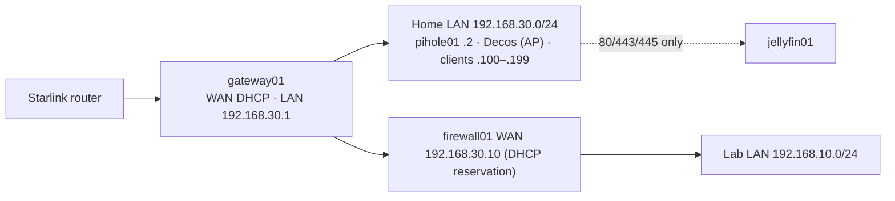

# Chapter 2 — Network: Home Edge, Starlink and Switching (August – September 2026)

## Goal

Move the whole household behind a pfSense **home-edge firewall (gateway01)** with **Pi-hole** DNS. Turn the Deco mesh into plain access points. Make the lab firewall (firewall01) a properly isolated second layer. It all had to be done without leaving the household offline, and with a one-cable emergency bypass.

## Design

- **Deliberate double NAT.** If gateway01 fails, the household is restored by moving one cable and switching the Deco back to router mode.
- **New internal bridge (`vmbr3`)** for the home LAN rather than another physical cable, because both firewalls run on the same host.
- **firewall01's WAN gets a DHCP static mapping** on gateway01, which keeps rules predictable without hard-coding an IP inside firewall01.

## What the live evidence changed (cutover runbook v2, 4–6 Sep 2026)

Before cutting over, I audited the real configuration instead of trusting the plan. That uncovered:

1. **firewall01's protected LAN and gateway01's home LAN shared one bridge**, so there was no Layer-2 isolation at all. This was fixed as part of the cutover.
2. A **dead NIC port** (`nic2`, no carrier on either end with any cable). Rebound the new bridge to `nic1`.
3. The Proxmox host's own management address no longer matched the upstream network, which was silently breaking Tailscale's coordination checks. Corrected.
4. A leftover NIC on gateway01, cloned from the gold template, was recorded for removal.

The cutover closed on 6 Sep 2026, with every phase validated.

## Starlink and the switch upgrade

- **Netgear GS324TP** (24-port PoE+) replaced the 8-port TP-Link (≈ 9 Sep). It has port-based **VLAN 10 Homelab** and **VLAN 30 Home**, with management on VLAN 10. *Lesson:* on this switch, VLAN membership and port PVID are separate settings that do not sync, and that cost hours of debugging. It has no CLI, so I wrote a **Playwright** script that drives its web UI to export the configuration for backup.
- **Starlink Gen 3** replaced the ISP link. The Starlink router now plugs straight into the homelab node, and the Ubiquiti NanoStation wireless bridge that used to carry the uplink between rooms was retired.
- Pi-hole serves household DNS, including `media.internal` for the media server. Android's system resolver will not resolve `.home.arpa` names, which is why that name exists.

## Skills demonstrated

Network design with trust boundaries, pfSense (DHCP static mappings, NAT, aliases, port forwards), Layer-2 isolation on Linux bridges, managed-switch VLANs (PVID versus membership), DNS design across several authorities, change planning with rollback, web-UI automation for network devices without a CLI.

## Records

[RUN-004 gateway01 cutover runbook](../02-network/firewalls/RUN-004-gateway01-home-edge-cutover-runbook.md) · [NET-001 Topology](../02-network/NET-001-network-topology.md) · [REG-001 Register](../02-network/REG-001-asset-and-network-register.md) · [NET-004 DNS](../02-network/NET-004-dns-registry.md) · [NET-005 Ports](../02-network/NET-005-port-registry.md) · [switch01](../02-network/switch/switch01-gs324tp.md) · [pfSense REST API privilege mapping](../02-network/firewalls/pfsense-rest-api-privilege-mapping.md)
