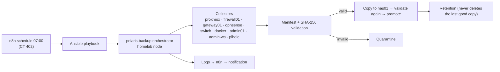

# Chapter 6 — Automation: The Config-Backup Framework (September 2026)

## Goal

Every device's configuration (three firewalls, the switch, three Proxmox nodes, Docker, the admin hosts, Pi-hole) collected **daily**, validated, archived on the NAS, and never silently lost.

## Architecture

Three tiers: **collectors** only collect, **framework utilities** verify, package and catalogue, and the **orchestrator** coordinates. Each collector returns one of three result codes (`NEW_OR_CHANGED`, `NO_CHANGE`, `FAILED`), and the orchestrator branches on that alone.

## Interesting engineering problems

| Problem | Resolution |
|---|---|
| The switch has no CLI or SSH | A Python Playwright script drives the web UI and exports the text configuration |
| Pi-hole needs a "generate export, then fetch" pattern | A second shared engine (`polaris-single-export-collector.sh`) alongside the firewall engine |
| Retention could delete a device's only backup | Found by reviewing real historical NAS contents. Fixed with a guard that always protects the last remaining copy |
| Several collectors always reported "changed" | Reading the code (not inferring from behaviour) showed the multi-file collectors had no comparison logic at all. Decision: they stay failure-detection-only, while single-file devices (firewalls, switch) get true hash-based change detection. The switch compares only `switch-configuration.txt`, which was proven byte-stable, and never the volatile tech-support dump |
| The cyberrange node runs hostile software | It has its own **API-only** orchestrator with a least-privilege token: no SSH from the trusted side into that node |
| AI-proposed code changes | The **merge-broker**: agents can open PRs; Forgejo branch protection plus a separate merge identity mean nothing reaches `main` without human approval. Forgejo blocks self-approval, and deploy keys are never write-scoped for agents |
| Quarantine actions between Windows and Linux hosts | **RecoveryRelay**: a deliberately narrow PowerShell named-pipe broker (Broker API v1, one action: `QUARANTINE`, strict JSON schema, LF-framed requests of 4 KB or less, one request per connection) between the recovery orchestrator on Admin-WS and a helper on Docker01 |
| Interrupted runs and lock ownership | Execution lock with a distinct "already running" exit code (5) that Ansible treats as skipped, not failed |

The framework evolved through 14 change "waves" (collector contract, shared SSH transport with multiplexing, manifest metadata, lifecycle, bootstrap paths, reporting and retention, orchestrator start-up, a collector registry, execution pipeline, export consolidation and framework normalization). Each wave was tagged with a baseline tarball.

## Skills demonstrated

Bash engineering at scale (shared libraries, result-code contracts, locking, quarantine and retention logic), Ansible, n8n workflow automation, Python and Playwright, git workflow with branch protection, least-privilege service identities, designing for failure.

## Code and records

[Framework code](../../code/config-backup/) · [Cyberrange backup](../../code/cyberrange-backup/) · [RecoveryRelay](../../code/recoveryrelay/) · [Phase 3 runbook](../09-automation/AI-PH3-nas01-config-backup-automation-runbook.md) · [Three-tier design](../09-automation/design/three-tier-framework-architecture.md) · [Change-waves plan](../09-automation/design/change-waves-plan.md) · [GOV-001 Backup policy](../10-operations/governance/GOV-001-backup-policy.md)
