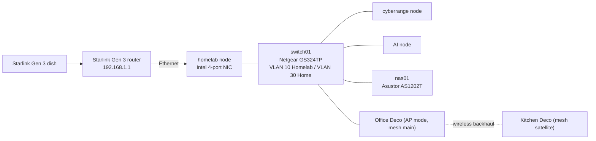
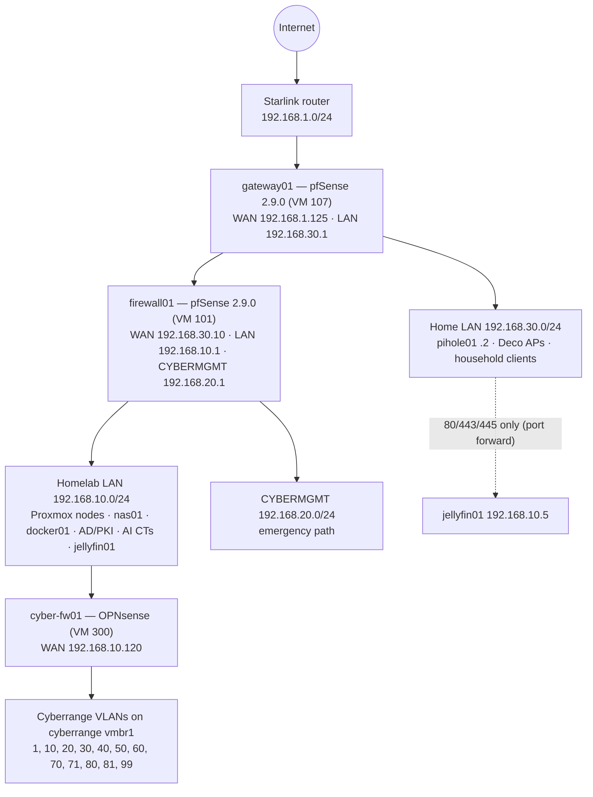
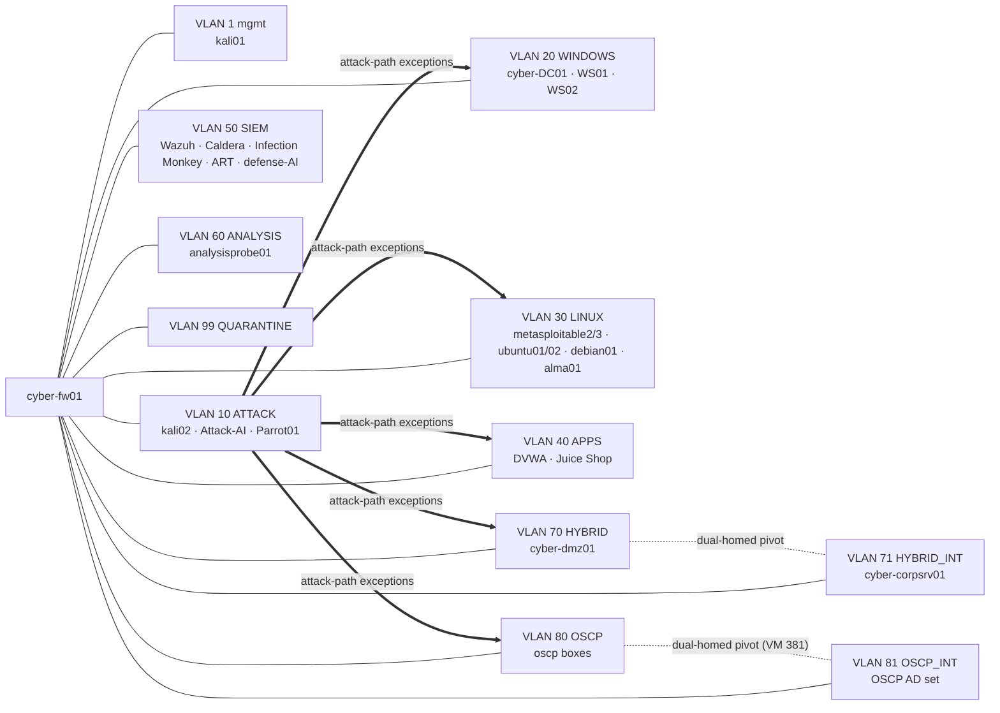

# NET-001 — Network Topology

| Field | Value |
|---|---|
| Document ID | NET-001 |
| Version | 1.0 |
| Status | Authoritative — current state |
| Effective | 16 October 2026 |
| Owner | Jesse Breedlove (Project Polaris) |
| Supersedes | `logical-topology.md`, `physical-topology.md`, `network-services.md`, `dependency-mapping.md` (Jul 2026) and the original `Homelab.drawio.png` |

Diagrams are in Mermaid so they render on GitHub and in MkDocs. Addresses come from [REG-001](REG-001-asset-and-network-register.md).

## 1. Physical path

- The Ubiquiti NanoStation bridge is **retired**. The Starlink router plugs straight into the homelab node, where gateway01 takes the WAN.
- The kitchen Deco keeps its old cable to the original modem position as an emergency bypass (Starlink router → Deco in router mode).
- switch01 port VLAN membership (VLAN Status page, 16 Oct 2026):

| VLAN | Name | Untagged member ports |
|---|---|---|
| 1 | Default | g9–g22, g25–g26 |
| 10 | Homelab | g3–g6, g23 |
| 30 | Home | g1–g2, g7–g8, g24 |

On this switch **VLAN membership and port PVID are separate settings that do not sync** — set both when moving a port (lesson from the GS324TP build, RUN-004 §1). The per-port device map is not yet recorded (MB-001 item).

## 2. Logical path and trust boundaries

| Boundary | Enforced by | Rule of thumb |
|---|---|---|
| Internet ↔ home | gateway01 | Double NAT; no inbound forwards from Starlink |
| Home ↔ homelab | firewall01 | Home can reach only jellyfin01 on 80/443/445 via `HOME_NET` → `JELLYFIN01` forward |
| Homelab ↔ cyberrange | cyber-fw01 + cyberrange host design | Cyber guests attach only to `vmbr1`; only cyber-fw01 spans `vmbr0` and `vmbr1`; no guest NAS mounts, second NICs or Tailscale |
| Between cyber zones | cyber-fw01 | Default deny; documented attack-path exceptions only (RUN-003 §7.4) |
| Cyber zones → protected space | cyber-fw01 `PROTECTED_NETWORKS` alias | Blocks 10/8, 172.16/12, 192.168/16, 100.64/10, 169.254/16; public Internet allowed and fails closed if cyber-fw01 is down (Gate 9, 14 Oct 2026) |
| Cyberrange AI ↔ homelab AI | Placement decision | Cyberrange AI runs only on the cyberrange node; it never talks to the AI node |

## 3. Cyberrange segmentation

## 4. Remote access

Tailscale gives break-glass access to the Proxmox nodes, the Matrix/Element front end for the AI agents, and remote Jellyfin for family devices. The cyberrange node is peer-isolated by tailnet ACL. Details and IPs: REG-001 §4.

## Revision history

| Version | Date | Summary |
|---|---|---|
| 1.0 | 16 Oct 2026 | First consolidated topology: Starlink edge, gateway01/firewall01 chain, GS324TP VLANs, cyberrange zones including 70/71/80/81 |
