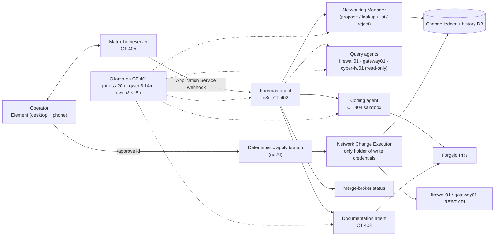

# AI-000 — AI Platform and Agent Ecosystem Overview

| Field | Value |
|---|---|
| Document ID | AI-000 |
| Version | 1.0 |
| Status | Current state |
| Effective | 16 October 2026 |
| Owner | Jesse Breedlove (Project Polaris) |
| Detailed records | `runbooks/AI-PH1` … `AI-PH5`, `../09-automation/AI-PH3-*` |

## 1. What it is

A self-hosted, local-LLM agent system that runs homelab operations from a chat window. The operator talks to a **Foreman** agent in Element (Matrix). The Foreman routes work to specialist agents that can read all three firewalls, propose firewall changes, write and test code in a sandbox, maintain documentation in Forgejo, and report on configuration backups. **No AI component can approve or apply a live change on its own.** The operator approves each change with a deterministic `/approve <id>` command.

## 2. Components

| Component | Host | Status (16 Oct 2026) |
|---|---|---|
| GPU inference (Ollama + ROCm) | CT 401 AI-Brain, RX 9060 XT 16 GB | Built 7 Sep 2026 |
| n8n + Ansible orchestration | CT 402 orchestrator-n8n | Built 8 Sep 2026; chat → agent → Ansible → Proxmox API pipeline proven |
| Config-backup automation (AI-reviewed) | homelab node (`/opt/project-polaris/config-backup`) + CT 402 + nas01 | Built 9–17 Sep 2026; daily 07:00 run |
| Merge-broker ("AI proposes, human commits") | Forgejo on docker01, `polaris-merge-broker` identity | Proven on both tiers across three repos (14 Sep 2026) |
| Documentation agent | CT 403 | Built; maintains Forgejo docs and the MkDocs site on docker01 |
| Coding agent | CT 404 | Built 27 Sep 2026: clone → write → run/test in a non-root sandbox → PR (`new`/`revise` modes; cap-out PRs labelled `[INCOMPLETE]`) |
| Matrix + Element + ntfy | CT 405, CT 402 | Built; push to phone |
| Foreman | n8n "Foreman" workflow | 13 top-level tools; per-room memory |
| Networking Manager + Executor | n8n "Networking Agent" folder | firewall01: aliases (entries, create/delete), rules, VLANs, interface `create`/DHCP proven live; gateway01 being built; cyber-fw01 read-only by design |
| Drift tracking | Query agents | Detects and logs configuration changes on all three firewalls |
| SearXNG web search | — | Planned |
| Proxmox node writes | — | Planned |

n8n workflow folders (16 Oct 2026): Networking Agent, Forgejo PR, Foreman, Coding Agent, Testing, Backup Scripts, Documentation Agent.

## 3. Safety architecture (the important part)

1. **Credential isolation.** No reasoning agent holds merge, push-to-main or device-write credentials. The Network Change Executor is the only component with a write-capable firewall credential, and it is never exposed as an AI tool.
2. **Approval is not an AI decision.** On 7 Oct 2026 testing showed that a model's narrated refusal and its actual tool calls can diverge in a single turn: the Foreman told the user it would not guess which change was meant, while the execution log showed it had already applied one. Prompt rules were replaced with a structural fix. Approval now happens only through `/approve <id>`, parsed by a non-AI branch, and the Review tool's AI-facing entry point hard-blocks `approve`.
3. **Ledger everything.** Every proposal, approval, rejection and apply result is written to a shared ledger and a permanent history database on CT 402.
4. **Re-verify at apply time.** Live state is re-read immediately before every write (for example, pfSense VLAN `id` is a live array index, not a stable key).
5. **Sandboxed code execution.** The coding agent runs as an unprivileged user with resource limits, `.git` lockout and closed Internet egress, and can only open PRs.

## 4. Separation from the cyber range

The cyber range has its own AI (Attack-AI CT 311 and defense-AI CT 351 on the cyberrange node's RX 7700 XT). It never connects to this platform, so deliberately malicious content cannot leak into homelab automation.

## 5. Lessons recorded (selection)

- A test that produces the right answer has not validated a rule unless that rule was the deciding factor. Check the execution trace, not just the reply.
- Any node with its own chat memory can repeat a stale answer. Force a fresh tool call for any question about current state.
- Vendor API "success" fields and "applies immediately" documentation have both been wrong. Verify each endpoint against an independent read.
- A capability that is wired in but not described in the system message is invisible to the agent, and therefore ungoverned.

Full findings log: `runbooks/AI-PH5-foreman-agent.md` → "Standing Principles" and "Findings Log".
